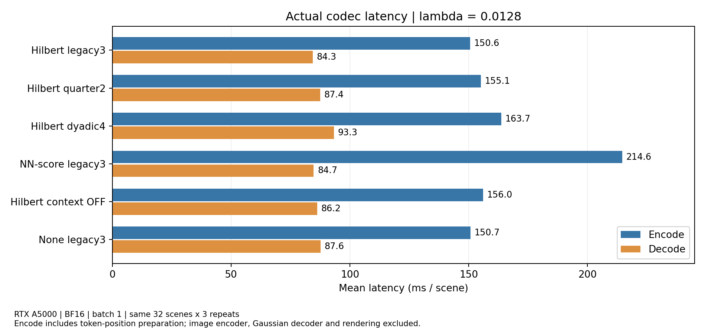
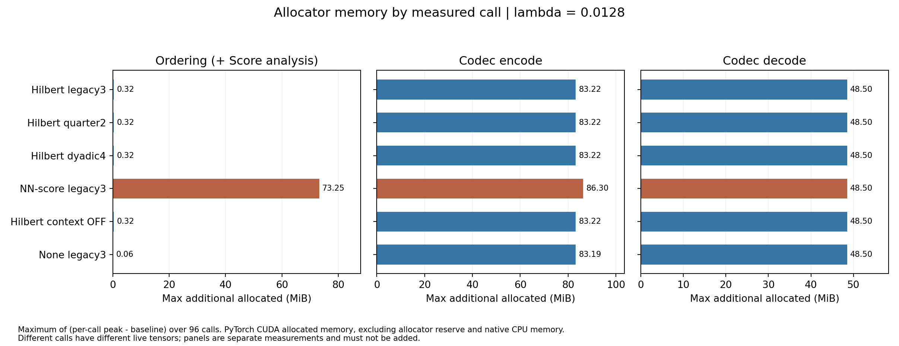

# Complexity 측정 결과 — job 455251 · 2026-10-17

37개 checkpoint의 실제 GPU 측정 결과를 검증했다. 같은 입력·같은 GPU에서 비교한 결과, Hilbert legacy3가 quarter2와 dyadic4보다 실제 encode/decode가 빨랐다. NN-score는 decoder 시간은 비슷하지만 encoder의 정렬 비용이 컸다.

## 검증한 측정 조건

- GPU: NVIDIA RTX A5000, host `ariel-v10`, UUID `21c12e72-9852-0433-10e9-0a86278ecac7`. 모든 point의 환경이 같다.
- Torch 2.5.1+cu121, CompressAI 1.2.8, CUDA runtime 12.1, BF16, batch1, 4096 tokens, CPU threads8.
- 같은 C12 입력 cache: warmup4장과 측정32장. Codec 구간은 scene당3회로 point당96회, image encoder와 token-position 준비는 scene당1회로 point당32회.
- 입력 fingerprint: `15da66efe5a9a47a3672193933034d576db64eb334c72c276ea40884079d6e72`. 37개 모두 fingerprint와 장면 순서가 같다.
- 37개 point·총3552개 반복 기록에서 요약 통계 10,656개를 원시 sample로 재계산했다. 저장값과 허용 부동소수점 반올림 범위에서 일치했다. Allocator peak−baseline 계산, 반복 간 payload byte 일치도 확인했다.
- Manifest의 37개 spec과 일치하며, 이전 static 측정의 활성/저장 파라미터 및 등록 신경망 MAC과도 일치한다.

## λ=.0128: 실제 시간과 메모리

시간은 32장×3회의 평균(ms/scene)이다. Encode는 `model.compress_scene_tokens`로 token-position 준비를 포함한다. Decode는 `feature_codec.decompress`이다. Image encoder, Gaussian decoder, renderer는 두 시간 열에서 제외된다.

추가 peak는 각 호출의 `max_memory_allocated − memory_allocated_before_call`을 구한 뒤 96회 중 최댓값을 취했다. 총 peak는 측정 harness에 이미 올라간 전체 모델과 남아 있는 tensor를 포함한다. 이 값은 독립 배포한 codec의 최소 VRAM이나 NVML 전체 사용량을 뜻하지 않는다.

| 설정 | Encode ms | Decode ms | 정렬 ms | Encode 총 peak MiB | Encode 추가 peak MiB | Decode 추가 peak MiB |
|---|---:|---:|---:|---:|---:|---:|
| Hilbert legacy3 | 150.583 | 84.279 | 6.054 | 511.957 | 83.220 | 48.503 |
| Hilbert quarter2 | 155.149 | 87.423 | 6.242 | 511.901 | 83.220 | 48.503 |
| Hilbert dyadic4 | 163.698 | 93.299 | 6.361 | 512.078 | 83.220 | 48.503 |
| NN-score legacy3 | 214.619 | 84.715 | 67.662 | 515.012 | 86.303 | 48.503 |
| Hilbert context OFF | 156.028 | 86.213 | 6.219 | 511.962 | 83.220 | 48.503 |
| None legacy3 | 150.710 | 87.644 | 0.109 | 511.853 | 83.188 | 48.503 |

- Hilbert dyadic4는 legacy3보다 encode +8.71%, decode +10.70%. Quarter2도 encode +3.03%, decode +3.73%로 더 느렸다.
- NN-score는 Hilbert legacy3보다 encode +42.52%, decode +0.52%. 정렬+Score 분석은 67.66ms 대 6.05ms다.
- 정렬 호출의 추가 peak는 NN-score 73.253MiB, Hilbert 0.316MiB. 그러나 codec encode 전체 추가 peak 차이는 3.083MiB다. 서로 다른 구간에서 peak가 발생하므로 정렬의 증가량을 전체 peak에 그대로 더하면 안 된다.
- 이 harness에서 λ=.0128의 image encoder 총 peak는 설정별 641.1–641.3MiB, 추가 peak는 약250.3MiB다. 이를 codec peak와 더해 end-to-end peak로 부르지 않는다.
- Context OFF도 기존 legacy3의 3단계×4채널그룹=12개 Score entropy streams를 유지한 모델이다. OFF가 이번 측정에서 더 빠르지는 않았다. 서로 학습된 Score 분포와 부호 길이도 달라 공간 예측 연산 삭제만의 인과 효과로 해석하지 않는다.

## 세 λ를 묶은 설정별 시간

각 λ의 평균 시간을 동일 가중으로 평균했다. 추가 메모리는 모든 λ/호출 중 최댓값이다. Morton legacy4만 λ=.0256 한 point다.

| 설정 | λ 개수 | 평균 Encode ms | 평균 Decode ms | Encode 추가 peak MiB | Decode 추가 peak MiB |
|---|---:|---:|---:|---:|---:|
| Morton legacy2 | 3 | 145.485 | 82.964 | 83.220 | 48.503 |
| Morton legacy3 | 3 | 148.933 | 85.618 | 83.220 | 48.503 |
| Hilbert legacy3 | 3 | 150.753 | 84.299 | 83.220 | 48.985 |
| Morton quarter2 | 3 | 151.869 | 88.078 | 83.220 | 48.503 |
| Hilbert quarter2 | 3 | 155.309 | 87.495 | 83.220 | 48.503 |
| Morton dyadic4 | 3 | 157.502 | 92.044 | 83.220 | 48.503 |
| Hilbert dyadic4 | 3 | 162.037 | 91.925 | 83.220 | 49.485 |
| NN-score legacy3 | 3 | 225.576 | 84.464 | 86.303 | 48.503 |
| None legacy3 | 3 | 150.940 | 88.339 | 83.188 | 48.503 |
| None quarter2 | 3 | 153.540 | 90.005 | 83.188 | 48.503 |
| None dyadic4 | 3 | 160.217 | 94.656 | 83.188 | 48.503 |
| Hilbert context OFF | 3 | 155.449 | 86.315 | 83.220 | 48.503 |
| Morton legacy4 | 1 | 154.590 | 88.510 | 83.220 | 48.503 |

NN-score의 정렬 시간은 λ=.0064에서 약103ms, .0128/.0256에서는 약68ms였다. 같은 GPU·입력이므로 λ에 따른 차이도 기록할 필요가 있다. 이 JSON에는 greedy fallback 횟수나 native CPU call stack이 없어 차이의 원인을 확정하지 않는다.

## 파라미터와 MAC

Encoder GMAC은 위치가 준비된 `feature_codec.compress` 경로다. 위 실제 시간의 encode 범위보다 좁다. Decoder GMAC은 `feature_codec.decompress`다. 등록된 행렬곱·convolution만 세므로 정렬 거리/비교, index/gather, 전송, rANS, 원소별 연산 등은 제외된다.

| 설정 | 활성 Params M | 저장 Params M | Codec core encode GMAC | Decode GMAC |
|---|---:|---:|---:|---:|
| Morton legacy2 | 4.585288 | 4.696560 | 6.967001 | 3.393454 |
| Morton legacy3 | 4.592920 | 4.704192 | 6.984040 | 3.410493 |
| Hilbert legacy3 | 4.592920 | 4.704192 | 6.984040 | 3.410493 |
| Morton quarter2 | 4.586400 | 4.701888 | 6.955074 | 3.381527 |
| Hilbert quarter2 | 4.586400 | 4.701888 | 6.955074 | 3.381527 |
| Morton dyadic4 | 4.593232 | 4.717152 | 6.955926 | 3.382378 |
| Hilbert dyadic4 | 4.593232 | 4.717152 | 6.955926 | 3.382378 |
| NN-score legacy3 | 4.592920 | 4.704192 | 7.152861 | 3.410493 |
| None legacy3 | 4.592920 | 4.704192 | 6.984040 | 3.410493 |
| None quarter2 | 4.586400 | 4.701888 | 6.955074 | 3.381527 |
| None dyadic4 | 4.593232 | 4.717152 | 6.955926 | 3.382378 |
| Hilbert context OFF | 4.584488 | 4.704192 | 6.949962 | 3.376415 |
| Morton legacy4 | 4.600552 | 4.711824 | 7.001080 | 3.427533 |

Quarter2/dyadic4는 predictor의 등록 MAC을 줄였지만 실제 시간은 legacy3보다 길었다. Dyadic4는 16개, legacy3는 12개의 Score entropy streams를 사용한다. 호출 횟수·작은 tensor 처리·entropy coding 등 MAC이 반영하지 않는 비용을 함께 봐야 한다. 현재 구간 측정은 이 비용들의 비율을 분리하지 않는다.

## 기존 전체 평가의 품질·용량과 함께 보기

아래 PSNR/bytes는 profile에서 새로 계산한 값이 아니라 manifest에 남아 있는 이전 전체 평가 값이다. 시간은 이번 통제된 profile을 사용하고, 32장 profile bytes를 전체 평가 bytes와 섞지 않는다.

| λ=.0128 모델 | 기존 PSNR dB | 기존 실제 bytes/scene | 이번 Encode ms | 이번 Decode ms |
|---|---:|---:|---:|---:|
| Hilbert legacy3 | 23.7032 | 39186.968 | 150.583 | 84.279 |
| Hilbert quarter2 | 23.7032 | 39751.099 | 155.149 | 87.423 |
| Hilbert dyadic4 | 23.7021 | 38071.103 | 163.698 | 93.299 |
| NN-score legacy3 | 23.7431 | 37837.647 | 214.619 | 84.715 |

λ=.0128에서 Hilbert dyadic4는 기존 평가의 PSNR이 legacy3와 비슷하고 실제 bytes가 약2.85% 작지만 이번 codec 시간은 약9–11% 길다. 속도를 우선하면 Hilbert legacy3, 그 정도 시간 증가를 허용하고 용량을 줄이려면 Hilbert dyadic4가 후보이다. 이는 해당 point에서 관찰한 절충이며 고정 품질 RD 우위를 확정한 결과가 아니다.
NN-score는 encode 지연을 감수하는 조건에서 고려할 수 있다. 이번 결과로 quarter2를 가장 빠른 후보로 분류했던 이전의 서로 다른 job 시간 비교를 수정한다. 같은 GPU/입력의 이번 측정에서는 legacy3가 더 빨랐다.

## 범위와 산출물

이번 목록은 기존 37개 point다. 새로 준비한 Hilbert Context OFF의 56채널 1 stream/4 streams 비교와 기본 순서+Context OFF 대조군은 포함하지 않는다. MSH 없는 모델, low-rank 없는 2-path, MSH 직접 압축과의 구조 비교도 포함하지 않는다.
GPU 메모리는 PyTorch CUDA allocated 기준이다. Reserved cache, CUDA context/driver, CPU rANS/native memory 및 별도의 학습 peak는 측정하지 않았다. 전체 모델을 함께 로드한 profiling harness의 기준이므로 codec 전용 receiver의 최소 VRAM으로 읽지 않는다.

- `audit.json`: 입력/환경/집계 재계산 검증 및 원본 SHA256.
- `measurements.json`: 37개 point의 구간별 시간·메모리, MAC, 파라미터, 이전 품질 지표와 설정별 요약.
- `01_latency_l0128.png/.pdf`, `02_memory_l0128.png/.pdf`: 같은 λ의 실제 시간과 추가 allocator 메모리.

## 37개 point 상세

총 peak는 encode 호출의 최대 allocated, 추가 peak는 호출 전 baseline을 뺀 최대 증가량이다. 두 열 모두 MiB다.

| Point | Encode ms | Decode ms | Encode p90 ms | Encode 총 peak | Encode 추가 peak | Decode 추가 peak | Profile bytes KiB |
|---|---:|---:|---:|---:|---:|---:|---:|
| hilbert_dyadic4_0p0064 | 162.312 | 92.101 | 172.223 | 510.404 | 82.296 | 49.485 | 46.967 |
| hilbert_dyadic4_0p0128 | 163.698 | 93.299 | 174.459 | 512.078 | 83.220 | 48.503 | 37.388 |
| hilbert_dyadic4_0p0256 | 160.102 | 90.374 | 170.450 | 512.056 | 83.220 | 48.503 | 29.560 |
| hilbert_legacy3_0p0064 | 151.097 | 84.864 | 153.915 | 510.006 | 81.237 | 48.985 | 47.120 |
| hilbert_legacy3_0p0128 | 150.583 | 84.279 | 153.327 | 511.957 | 83.220 | 48.503 | 38.469 |
| hilbert_legacy3_0p0256 | 150.578 | 83.755 | 153.045 | 511.941 | 83.220 | 48.503 | 30.457 |
| hilbert_quarter2_0p0064 | 155.415 | 88.045 | 158.663 | 511.908 | 83.220 | 48.503 | 48.504 |
| hilbert_quarter2_0p0128 | 155.149 | 87.423 | 156.789 | 511.901 | 83.220 | 48.503 | 39.048 |
| hilbert_quarter2_0p0256 | 155.364 | 87.018 | 157.439 | 511.890 | 83.220 | 48.503 | 30.779 |
| morton_dyadic4_0p0064 | 158.214 | 92.313 | 161.024 | 512.091 | 83.220 | 48.503 | 47.708 |
| morton_dyadic4_0p0128 | 157.982 | 91.910 | 161.107 | 512.068 | 83.220 | 48.503 | 38.154 |
| morton_dyadic4_0p0256 | 156.310 | 91.909 | 158.881 | 512.054 | 83.220 | 48.503 | 30.145 |
| morton_legacy2_0p0064 | 145.638 | 83.779 | 147.604 | 511.881 | 83.220 | 48.503 | 50.748 |
| morton_legacy2_0p0128 | 143.712 | 82.493 | 146.247 | 511.866 | 83.220 | 48.503 | 41.078 |
| morton_legacy2_0p0256 | 147.106 | 82.620 | 145.914 | 511.866 | 83.220 | 48.503 | 32.904 |
| morton_legacy3_0p0064 | 150.281 | 86.692 | 152.245 | 511.975 | 83.220 | 48.503 | 47.811 |
| morton_legacy3_0p0128 | 148.875 | 85.480 | 150.972 | 511.954 | 83.220 | 48.503 | 39.244 |
| morton_legacy3_0p0256 | 147.643 | 84.682 | 149.610 | 511.945 | 83.220 | 48.503 | 31.008 |
| morton_quarter2_0p0064 | 152.587 | 88.560 | 154.939 | 511.910 | 83.220 | 48.503 | 48.620 |
| morton_quarter2_0p0128 | 152.079 | 88.118 | 154.400 | 511.894 | 83.220 | 48.503 | 39.215 |
| morton_quarter2_0p0256 | 150.939 | 87.556 | 152.699 | 511.889 | 83.220 | 48.503 | 31.346 |
| nn_score_0p0256 | 211.560 | 83.145 | 216.035 | 515.001 | 86.303 | 48.503 | 29.515 |
| nn_score_0p0064 | 250.549 | 85.532 | 255.922 | 515.023 | 86.303 | 48.503 | 45.288 |
| nn_score_0p0128 | 214.619 | 84.715 | 219.854 | 515.012 | 86.303 | 48.503 | 37.186 |
| context_only_0p0064 | 152.336 | 90.339 | 157.556 | 511.870 | 83.188 | 48.503 | 56.203 |
| context_only_0p0128 | 150.710 | 87.644 | 153.310 | 511.853 | 83.188 | 48.503 | 46.919 |
| context_only_0p0256 | 149.774 | 87.035 | 151.611 | 511.835 | 83.188 | 48.503 | 38.640 |
| hilbert_only_0p0064 | 156.037 | 86.961 | 158.219 | 511.974 | 83.220 | 48.503 | 55.573 |
| hilbert_only_0p0128 | 156.028 | 86.213 | 158.176 | 511.962 | 83.220 | 48.503 | 45.194 |
| hilbert_only_0p0256 | 154.282 | 85.772 | 156.439 | 511.959 | 83.220 | 48.503 | 36.108 |
| context_quarter2_0p0064 | 154.604 | 90.900 | 156.330 | 511.801 | 83.188 | 48.503 | 55.961 |
| context_quarter2_0p0128 | 153.689 | 89.892 | 155.983 | 511.790 | 83.188 | 48.503 | 47.191 |
| context_quarter2_0p0256 | 152.328 | 89.222 | 154.676 | 511.778 | 83.188 | 48.503 | 38.774 |
| context_dyadic4_0p0064 | 162.469 | 96.380 | 165.164 | 511.992 | 83.188 | 48.503 | 56.133 |
| context_dyadic4_0p0128 | 159.527 | 94.187 | 162.656 | 511.972 | 83.188 | 48.503 | 47.168 |
| context_dyadic4_0p0256 | 158.653 | 93.400 | 161.217 | 511.949 | 83.188 | 48.503 | 38.686 |
| morton_legacy4_0p0256 | 154.590 | 88.510 | 157.691 | 512.019 | 83.220 | 48.503 | 30.932 |
