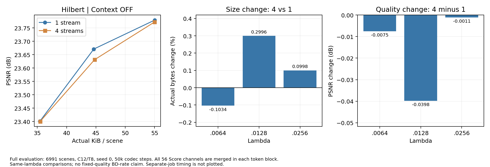

# 로그 검토 — 2026-10-18

다운로드된 10월 18일 오전 9:04경 자료 기준이다. 원격 Slurm의 실시간 상태를 조회한 결과는 아니다.

## 확인 결과

- Hilbert Context OFF의 1/4 stream 실험: 학습 6개 모두 50k 완료, 평가 6개 모두 6991장 결과 출력 완료.
- 추가 λ 실험: 받은 state에는 13개 중 9개가 접수돼 있다. 학습 8개에 진행 로그가 있고, Morton+dyadic4 .0512의 455343은 아직 다운로드된 시작 로그가 없다.
- 추가 λ의 학습 종료·평가 결과는 아직 이 자료에 없다. 받은 학습·평가 로그에서 traceback, OOM, ENOSPC, 시간 제한 종료 등 치명 오류는 발견하지 않았다.
- λ=.0512의 Hilbert legacy3, Morton legacy3, None dyadic4, Hilbert single Context OFF는 받은 state에 새 ID가 없다.

## Context OFF: 1 stream과 4 streams

두 조건 모두 Hilbert, rank56, MSH ON, spatial/mean/channel context OFF, 56채널 통합이다. 4 streams는 token을 dyadic4의 512/512/1024/2048로 나누고 블록별 확률모델을 사용한다. 같은 부모·초기 분포에서 각각 새 50k를 학습했다.

| λ | 1 stream PSNR | 4 streams PSNR | 1 stream bytes | 4 streams bytes | 4 vs 1 용량 변화 |
|---|---:|---:|---:|---:|---:|
| .0064 | 23.7795 | 23.7720 | 56350.853 | 56292.589 | −0.103% |
| .0128 | 23.6710 | 23.6312 | 45706.522 | 45843.453 | +0.300% |
| .0256 | 23.4012 | 23.4001 | 36308.981 | 36345.202 | +0.100% |



세 λ 모두 전체 용량 차이는 0.3% 이내다. .0128에서는 1 stream이 PSNR도 높고 전체 용량도 작다. .0064에서는 4 streams가 58.264 bytes 작지만 PSNR도 0.0075dB 낮다. .0256에서는 1 stream이 36.220 bytes 작고 PSNR도 0.0011dB 높다. 현재 결과는 단순 4분할의 압축 이득을 보여주지 않으며, Context OFF를 1 stream으로 선택한 근거가 된다.

동일 λ의 관찰이며 고정 품질 bitrate 절감이나 학습 변동성에 대한 통계적 유의성을 주장하지 않는다. 이전 dyadic4 Context ON 결과와 연결할 때는 그 모델이 채널 4그룹/16 strings라는 점도 반영한다.

### Stream별 용량 변화

| λ | 4−1 Score bytes | 4−1 MSH y+z bytes | 4−1 전체 bytes |
|---|---:|---:|---:|
| .0064 | −190.407 | +132.142 | −58.264 |
| .0128 | −99.295 | +236.227 | +136.931 |
| .0256 | +6.507 | +29.714 | +36.220 |

λ=.0128의 4 streams는 Score가 약 99.3 bytes 줄지만 MSH y/z가 약 236.2 bytes 증가해 총 136.9 bytes 커졌다. 여섯 평가 모두 Score+MSH y+MSH z+mean+container의 합이 전체 bytes와 출력 반올림 범위 내에서 일치했다. Mean은 0 bytes, outer container는 132 bytes다.

### 평가 시간과 완료 확인

| λ | 1 stream enc/dec ms | 4 streams enc/dec ms | 1 stream train/eval | 4 streams train/eval |
|---|---:|---:|---|---|
| .0064 | 140.9 / 78.3 | 147.0 / 82.2 | 455235 / 455236 | 455241 / 455242 |
| .0128 | 139.6 / 77.4 | 142.6 / 79.4 | 455237 / 455238 | 455243 / 455244 |
| .0256 | 142.6 / 78.2 | 141.1 / 78.6 | 455239 / 455240 | 455245 / 455246 |

서로 다른 eval job의 평균이므로 엄격한 속도 순위로 해석하지 않는다. 총 평가 6991장, 앞 5장을 뺀 시간 집계 6986회가 모두 일치한다. 동일 C12/T8·seed0 설정을 확인했지만, per-scene JSON이 없어 장면별 frame 일치는 별도로 대조하지 않았다.

Dataloader의 7286 표기는 길이 추정치다. 6991에서 정상적인 최종 지표·pipeline 출력이 나왔으므로 96% 표시만으로 평가 중단으로 판단하지 않는다. 여섯 학습의 `.err`에는 모두 `max_steps=50000 reached`가 있다.

## 추가 λ 학습 진행

전체 목표는 optimizer 50k steps다. 표시된 epoch 배치 수에 accumulation=2를 적용해 진행률을 추정했다. Epoch의 80%를 전체 학습 80%로 읽지 않는다. 이 환산은 완료된 여섯 모델의 마지막 epoch3/batch946에서 50k가 되는 것으로 교차 확인했다.

ETA는 마지막 진행 속도를 유지할 때의 학습 잔여다. 다운로드 이후 경과 시간·대기·평가 시간은 포함하지 않는다.

| Train | 순서 / schedule | λ | 추정 step/50k | 전체 진행률 | 로그 기준 학습 잔여 |
|---|---|---:|---:|---:|---:|
| 455327 | Hilbert / dyadic4 | 0 | 47236 | 94.5% | 약 1.0h |
| 455329 | Hilbert / dyadic4 | .0032 | 47752 | 95.5% | 약 0.8h |
| 455331 | Morton / dyadic4 | .0032 | 13182 | 26.4% | 약 13.4h |
| 455333 | Hilbert / legacy3 | .0032 | 13681 | 27.4% | 약 12.6h |
| 455335 | Morton / legacy3 | .0032 | 13484 | 27.0% | 약 12.8h |
| 455337 | None / dyadic4 | .0032 | 12103 | 24.2% | 약 14.2h |
| 455339 | Hilbert / single OFF | .0032 | 13999 | 28.0% | 약 11.4h |
| 455341 | Hilbert / dyadic4 | .0512 | 2878 | 5.8% | 약 22.0h |
| 455343 | Morton / dyadic4 | .0512 | 시작 로그 없음 | — | — |

받은 train 명령에서 λ=0을 포함한 각 λ 전달값, schedule, Ceph TMPDIR 사용을 확인했다. 추가 λ eval 455328/455330/455332/455334/455336/455338/455340/455342/455344의 결과 로그는 아직 없다. 접수 ID만으로 대기·실행·완료 상태를 확정하지 않는다.

## 남은 제출

받은 state 기준으로 λ=.0512의 Hilbert legacy3, Morton legacy3, None dyadic4, Hilbert single Context OFF 4개 point가 남았다. Train 4개+eval 4개다. 제출 여유가 생기면 다음 명령이 접수된 ID를 재사용하고 빠진 부분만 이어간다.

```bash
cd -P /ceph_data/clue9986/tokencomp/upstream/globalsplat
bash scripts/slurm/submit_nfcgs_order_context_extremes.sh
```

실시간 큐가 필요하면 다음 명령으로 기록된 job 상태를 확인한다.

```bash
squeue -j 455327,455328,455329,455330,455331,455332,455333,455334,455335,455336,455337,455338,455339,455340,455341,455342,455343,455344 -o '%.18i %.24j %.10T %.30R'
```

`review.json`에 전체 6개 평가 지표, 9개 학습 상태, stream별 차이, 입력 로그 크기와 SHA256을 보존했다. 모델·제출 코드 수정이나 원격 job 조작은 수행하지 않았다.
